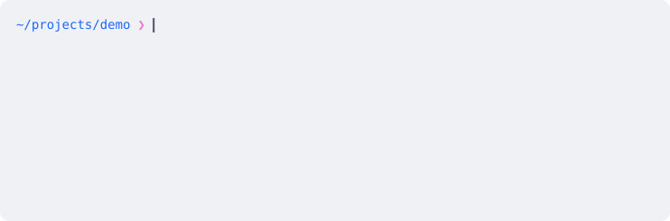

# inkline

zsh-style autosuggestions and syntax highlighting for bash, and nothing else.

<picture>
  <source media="(prefers-color-scheme: dark)" srcset="demo/demo-dark.svg">
  
</picture>

<sub>Typed live into bash + inkline through a pty (scripted by
[`demo/record.py`](demo/record.py)). Shown with Omarchy's Tokyo Night or
Catppuccin Latte palette depending on your GitHub theme; inkline only uses the
terminal's palette colours, so it takes on whatever theme the terminal has.</sub>

It is a bash loadable builtin written in Rust. GNU readline stays the line
editor (your inputrc, `bind`, Tab completion, fzf widgets keep working);
inkline decorates readline's output and follows the zsh plugins' rules:

- **Autosuggestions** as in zsh-autosuggestions 0.7.1 (default `history`
  strategy, `fg=8`): the newest history entry starting with the buffer, shown
  after the buffer wherever the cursor is, multi-line entries included.
- **Syntax highlighting** with zsh-syntax-highlighting 0.8.0's `main`
  highlighter defaults applied to bash syntax: commands/aliases/functions/
  builtins green, unknown commands bold red, reserved words, strings and
  redirections yellow, `$var` and escapes inside quotes cyan, existing paths and
  path prefixes underlined, `*`/`?` blue, `$(…)`/backquote delimiters magenta,
  precommands (`sudo`, `command`, `exec`, `nice`, …) green underlined with their
  option arguments understood, comments `fg=black,bold`.

| Key | With a suggestion shown |
| --- | --- |
| Right, End, Ctrl-F, Ctrl-E (cursor at the end) | accept it |
| Ctrl-Y (`inkline-accept`, zsh's `autosuggest-accept`) | accept it |
| Alt-F, vi `w`/`e`/… (forward-word motions) | accept as far as the motion moves |
| Up/Down, history search | hide it until you edit |

## Install

Needs Linux, Rust 1.85+ and bash linked against GNU readline 8.x. Developed and
tested on Arch Linux (bash 5.3, readline 8.3); inkline checks the readline
version when it loads and refuses anything else.

```bash
git clone https://github.com/ramtinJ95/inkline ~/src/inkline
cd ~/src/inkline
cargo build --release
install -Dm755 target/release/libinkline.so ~/.local/lib/bash/inkline.so
```

Then add to `~/.bashrc`, after any `bind`/inputrc setup, and remove ble.sh or
other line-editor plugins if you have them:

```bash
if [[ $- == *i* ]]; then
  enable -f ~/.local/lib/bash/inkline.so inkline
fi
```

Open a new terminal and check:

```console
$ inkline status
inkline 0.1.0 (active), readline 8.3
frames 3  highlighted 3  layout mismatches 0  terminal repairs 0  resizes 0  internal errors 0  wrapped commands 52
```

`inkline off` / `inkline on` toggle it for the current shell.

**Update:** `git pull`, rebuild and run the same `install` command; new shells
load the new build, running ones keep theirs. **Uninstall:** delete the
`enable -f` line and `~/.local/lib/bash/inkline.so`.

## Performance

Typing real commands at 80 ms per key into each shell through a pty, 838
keystrokes per shell, measured by [`bench/compare.sh`](bench/compare.sh):

| | CPU per keystroke<br>median / p90 | Redraw finished<br>median / p90 | Paste, CPU per char | Enter → next prompt | Shell startup |
| --- | ---: | ---: | ---: | ---: | ---: |
| plain bash (readline) | 96 / 145 µs | 0.33 / 0.51 ms | 13 µs | 32 ms | 130 ms |
| **bash + inkline** | **181 / 266 µs** | **0.36 / 0.55 ms** | **16 µs** | **34 ms** | **146 ms** |
| zsh + zsh-autosuggestions + zsh-syntax-highlighting | 7672 / 14002 µs | 1.36 / 9.69 ms | 1262 µs | 71 ms | 84 ms |

inkline adds about 0.1 ms of CPU per keystroke on top of readline; the zsh
plugins it replicates take 40–50 times as much as bash + inkline. The slowest
inkline keystroke of the run (3.6 ms) is the first command lookup in a new
shell, which indexes `$PATH`; loading the builtin adds about 16 ms to startup.

<sub>AMD Ryzen 7 PRO 6850U, `low-power` platform profile, bash 5.3.20,
zsh 5.9.2, both with the same starship prompt and history. CPU time is the
shell process's own, from `/proc/<pid>/schedstat`; redraw time is until the
last byte of the shell's response.</sub>

`bench/compare.sh [BASHRC]` reproduces this. zsh and the two plugins come from
the official Arch packages (signature-checked, unpacked into
`~/.cache/inkline-bench`, not installed), with a `.zshrc` mirroring a typical
macOS setup; the bashrc (default `~/.bashrc`) must load inkline, and is run
once with and once without it.

## How it works

- While readline redraws, the suggestion is temporarily part of the line
  buffer, so readline itself wraps, scrolls and erases it like typed text.
- inkline then recolours the cells. Their positions come from a
  reimplementation of readline 8.3's line layout (wrapping, wide characters,
  tabs, `^X` control characters, newlines), checked against readline's real
  cursor and bottom row before anything is painted; if they disagree the frame
  is redrawn without the suggestion, so it can never look like typed text.
  `inkline status` counts such "layout mismatches" (expected: 0).
- Accept-line, completion listings and other printing commands first redraw
  without the suggestion; Ctrl-C clears it, keeping readline's `^C`. Nothing
  grey ends up in scrollback.
- Every entry point runs under `catch_unwind`; an internal error disables
  inkline for that shell and readline carries on. The library pins itself so
  `enable -d inkline` cannot leave dangling pointers in readline.

## Tests

```bash
cargo test --release                        # unit tests + property fuzz (3000 cases each)
INKLINE_FUZZ_ITERS=200000 cargo test --release --test fuzz   # long fuzz; INKLINE_FUZZ_SEED=n to vary
python3 -m venv .venv && .venv/bin/pip install pyte
.venv/bin/python tests/screen_test.py       # real bash in a pty, checked through a terminal emulator
.venv/bin/python tests/screen_test.py --rc ~/some-rc-without-ble   # plus your own prompt/inputrc
.venv/bin/python tests/fuzz_screen.py --seeds 8 --steps 300 [--rc FILE]
.venv/bin/python demo/record.py             # re-record the demo above
```

- `tests/fuzz.rs`: random shell-like and hostile input (invalid UTF-8, control
  and zero-width characters, wide characters, narrow screens). The
  highlighter must not panic and must style every byte; layouts must be
  ordered, non-overlapping and inside the screen; repaint output replayed in a
  small VT model must put every cell in place and restore the cursor; the
  suggestion cache must equal a fresh history lookup.
- `tests/fuzz_screen.py`: the same random key stream (typing, motions, kills,
  history search, Tab, Ctrl-C, Ctrl-L, terminal resizes) goes to bash with
  inkline and to plain bash; after every key the screen text (suggestion
  blanked) and cursor must match. Accepted suggestions are copied into the
  plain shell.

## Differences from zsh that remain

- `yank`/`yank-pop`: zsh-autosuggestions leaves the previous suggestion
  displayed (they are "ignore" widgets); inkline fetches one for the new buffer.
- vi `f`/`t` character search is not a partial-accept motion.
- Highlighting applies zsh-syntax-highlighting's rules to bash syntax; zsh-only
  constructs (`noglob`, `=cmd`, global/suffix aliases) do not exist in bash.
